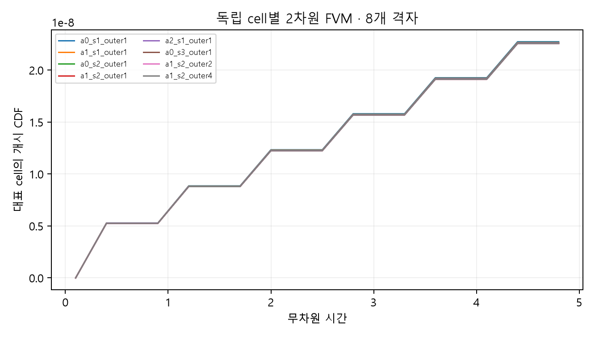
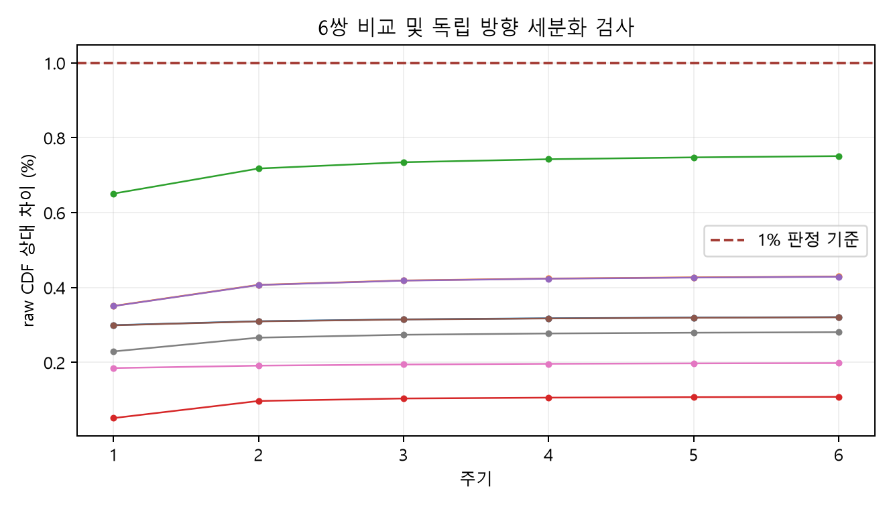

# 독립 cell별 2차원 FVM

2026년 11월 18일 완료한 coherent_g4 수치 검증의 실행 코드와 결과다. 8개 격자에서 6주기 24구간씩 총 192구간을 전파했다. 모든 판정값을 원시 CDF로 비교했다.

한 대표 cell에서 a₁=a₂=a, s₁=s₂=s인 동조 운동을 가정한다. 원래 G4의 에너지 항을 유지하고 유효 이동도는 (0.5, 0.025), 열에너지는 0.02를 사용한다. 각 cell의 a,s 공동분포를 계산하며, 지정한 하중이력 아래 물리 cell 사이의 독립성을 가정한다. s는 하중에 따라 되돌아갈 수 있는 상대 미끄럼 좌표다. 실제 특성체적·이동도·물리 시간의 보정은 남아 있다.

## 실행

이 폴더에서 Python 3.13과 기록된 NumPy·SciPy 버전으로 실행한다. Windows의 RUN_CELL2D.cmd도 같은 전파기를 실행한다.

```powershell
python -m pip install -r requirements-cell2d.txt
python independent_cells/verify_2d.py
python independent_cells/verify_stiff_restart.py
python independent_cells/verify_fast.py
python independent_cells/run_family.py --out outputs/fvm-cell2d/new_run --base-s 1 --refine 3 --workers 4
```

새 계산은 new_run에 저장한다. 확정 결과는 [FINAL_CHECKS.json](outputs/fvm-cell2d/FINAL_CHECKS.json)과 [192개 구간의 격자별 기록](outputs/fvm-cell2d/attempt_normal3_s1)에 있다.

## 판정값

| 검사 | 실제 최대값 | 기준 |
|---|---:|---:|
| 공간 상대차이 | 0.007508999099589363 | ≤0.01 |
| 외곽 절대차이 | 1.6543612251060553e-23 | ≤1e-12 |
| 시간전파 L1 차이 | 1.6867158961130817e-12 | <2e-12 |
| 시간전파 CDF 차이 | 1.4957847542510357e-16 | <2e-15 |
| 질량잔차 | 1.067035348967238e-12 | <1e-9 |
| 음수 질량 | 2.319947846400385e-22 | <2e-12 |
| 미해상 질량 U | 0 | ≤1e-13 |

## 결과 그림



각 선은 한 격자에서 계산한 대표 cell의 누적 개시확률이다. 가로축은 모형 시간이며, 매 주기의 하중 네 구간을 전파한 이력을 표시한다.



각 선은 격자 쌍의 주기 끝 CDF 상대차이다. 점선은 1% 기준이다. 두 그림의 원자료는 함께 제공한 records.json과 FINAL_CHECKS.json에 있다.

## 출처

계산 코드와 격자 입력의 바이트는 11월 18일 검증본과 같다. 공개용 JSON 기록의 개인 PC 경로는 상대적인 출처 표기로 바꿨다. 원본 기록의 SHA256은 SOURCE_PROVENANCE.json에 남겼다. PDF와 Word는 검수한 원본 파일을 제공한다. CRAM 계수의 출처와 라이선스는 cram_action.py와 OPENMC_LICENSE.txt에 있다.
